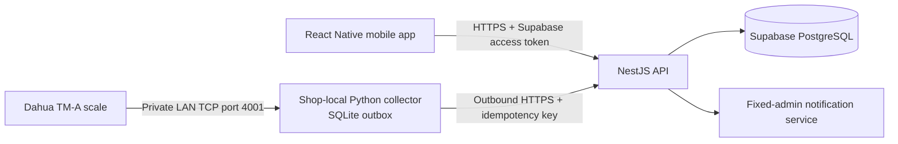
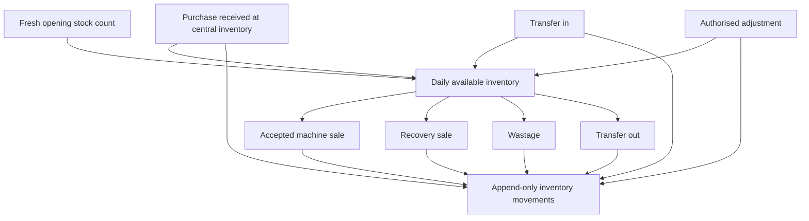
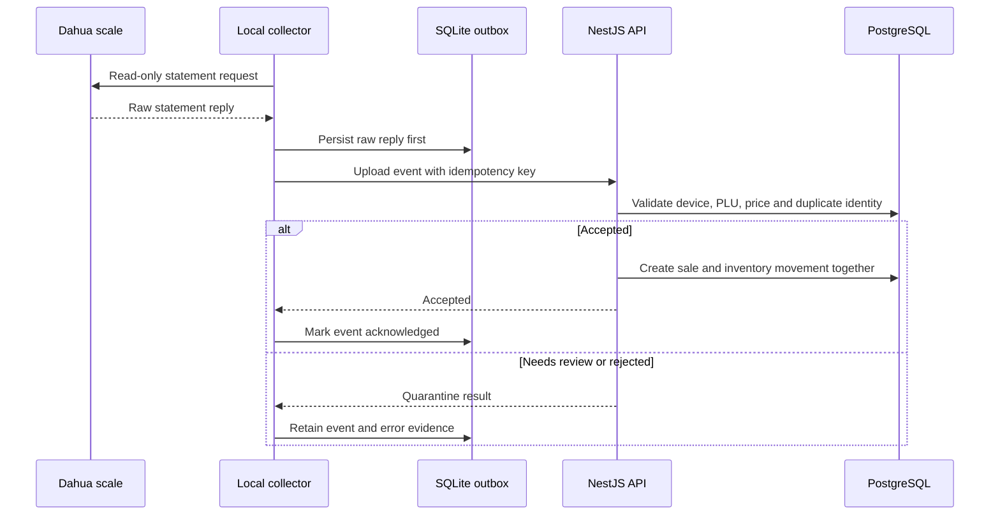

# Multi-Shop Inventory Platform

An inventory management system for a fruit and vegetable business with central inventory, multiple shops, weighing-machine sales, and a mobile application.

The project is at a documented pre-production milestone. The core backend modules and full mobile UI prototype are present. Supabase provisioning, live mobile repositories, and verified weighing-machine ingestion must be completed before real operations begin.

The latest backend increment adds owner-only machine registration, shop-scoped machine listing, and atomic CSV product/PLU/opening-stock imports. See [Shop and machine integration](docs/shop-machine-integration.md) for the API contracts, CSV format, machine identification rules and remaining live-integration work. Registration does not connect to or program the physical scale.

## What this application manages

- Central inventory and multiple shop locations
- Products, PLUs, selling prices, recovery percentages, and price history
- Fresh physical opening-stock counts each business day
- Suppliers, purchases, and stock received at central inventory
- Transfers between central inventory and shops
- Machine-based sales, once the device protocol is verified
- Wastage, recovery sales, expenses, and authorised stock adjustments
- Low-stock alerts, reports, PDF exports, users, roles, and audit history

Version 1 excludes customers, loyalty, sales returns, FIFO, stock aging, supplier payment settlement, and full mobile offline mode.

## Architecture



The mobile app never writes inventory tables directly. The NestJS API is the authority for access control, business rules, stock movement, idempotency, and audit history.

The Dahua scale is not exposed to the internet. A small collector running on a shop PC or mini-PC reads it locally and uploads only through outbound HTTPS.

## Stock movement model



All quantities are represented as integer grams and all money as integer paise in the backend. Stock-changing operations must be transactional and idempotent.

## Weighing-machine safety flow



The live Dahua parser is intentionally not complete yet. Real captures must prove field units, receipt grouping, and duplicate identity before an event can change inventory.

## Current status

| Area | Present now | Not ready yet |
| --- | --- | --- |
| NestJS API | Auth, shop scope, products, prices, opening stock, purchases, transfers, wastage, expenses, recovery sales, idempotency | Provisioned database, integration tests, report APIs, notification APIs, ingestion APIs |
| Database | Drizzle schema and migrations | Staging Supabase application and migration verification |
| React Native app | Separate demo and authenticated live operational workspace | Staging acceptance, remaining admin/purchase/history screens, native CSV file picker |
| Dahua tooling | Read-only diagnostic, collision-detecting outbox; API machine registration and PLU mappings | Secure pairing, parser validation, physical PLU synchronization, sale ingestion |
| Deployment | Cloud Run and Supabase design documents | Staging deployment, monitoring, backups, production pilot |

## Mobile UI coverage

The app contains navigable preview screens for:

- Today dashboard, inventory, activity, low-stock alerts, and reports
- Opening stock, purchases, suppliers, transfers, wastage, recovery sales, and expenses
- Machine sale list and receipt detail
- Products, product details, price history, shops, users, devices, PLU mapping, adjustments, audit history, and account
- Administrator and shop-user preview modes

The visual direction is operational and quick to scan, with compact native typography, bright action accents, and restrained surfaces. It does not bundle or copy a proprietary Blinkit font.

Without usable Supabase configuration, the original screens run as a demo and never change the database. With configuration, the app opens sign-in and the live workspace in `apps/mobile/src/live/LiveApp.tsx`. It reads the authenticated role, assigned shops, products, inventory and registered machines from the API. It supports live opening stock, CSV-content import, machine registration, PLU mapping, price changes, transfers, wastage, recovery sales and expenses. Other preview screens have not yet been converted to live workflows. See [consistency fixes and verification](docs/consistency-fixes.md).

Read connection failures are displayed explicitly. A demo option is offered for service/network failures, never as a successful save or as a workaround for denied access. Native CSV file selection is pending; the live form currently accepts pasted CSV contents. An uncertain write can be retried unchanged with the same in-memory key. Do not restart the app to retry an uncertain write; persistent reconciliation is not implemented.

## Repository layout

```text
apps/
  api/                 NestJS API and Drizzle PostgreSQL schema
  mobile/              Expo and React Native application
  collector/           Python Dahua diagnostic and collector foundation
docs/                  Architecture, security, deployment, and handover documentation
```

## Requirements

- Node.js 22 or later
- npm 11 or later
- Python 3.11 or later
- PostgreSQL or a Supabase staging project for database integration testing
- Expo Go on an Android phone for the easiest current UI preview

## Install once

Run these commands from the repository root:

```powershell
npm install
Copy-Item apps\api\.env.example apps\api\.env
Copy-Item apps\mobile\.env.example apps\mobile\.env
```

The mobile UI runs with dummy data if `apps/mobile/.env` has no configured Supabase values. Keep generated `.env` files local and do not commit them.

## See the mobile UI

The frontend can be viewed before Supabase or the backend is configured because it falls back to preview data.

### Android phone with Expo Go

1. Install Expo Go from the Google Play Store on the phone.
2. Connect the computer and phone to the same local Wi-Fi network.
3. Start the Expo development server:

```powershell
npm run mobile:start
```

4. Expo prints a QR code in the terminal and usually opens its developer page.
5. Open Expo Go, scan the QR code, and wait for the preview to load.

If the QR connection fails, use the Expo developer page to switch the connection mode or temporarily use the tunnel mode. The app can still be reviewed with dummy data.

### Android emulator

With an Android emulator and Android Studio already installed:

```powershell
npm run android --workspace=@inventory/mobile
```

Start the emulator first. Expo will build and open the preview on it.

### Browser preview

Browser support requires Expo web dependencies. Install them only if browser preview is needed:

```powershell
Set-Location apps\mobile
npx expo install react-dom react-native-web @expo/metro-runtime
npm run web
```

The Android Expo Go path is the recommended current review path because the application is designed as a mobile app.

## Start the backend

The backend needs a valid `apps/api/.env` file. The API will not start without `CORS_ORIGIN`.

```powershell
npm run api:start:dev
```

When running locally, the default API address is:

```text
http://localhost:3000
```

Useful URLs:

| Purpose | URL |
| --- | --- |
| Readiness health check | `http://localhost:3000/api/v1/health/ready` |
| OpenAPI documentation | `http://localhost:3000/api/docs` |
| OpenAPI JSON | `http://localhost:3000/api/openapi.json` |

For a physical mobile device, set `EXPO_PUBLIC_API_BASE_URL` to the computer's LAN address, for example `http://192.168.1.10:3000/api/v1`. Do not use `localhost`, because on the phone it refers to the phone itself.

## Validate the project

```powershell
npm run api:check
npm run api:test
npm run api:build
npm run mobile:typecheck
```

Run collector tests separately:

```powershell
Set-Location apps\collector
py -m unittest discover -s tests -v
```

## Supabase setup

Use a staging Supabase project before production.

1. Create a Supabase project in the intended region.
2. Enable email and password authentication.
3. Create a test administrator account.
4. Put the PostgreSQL connection string in `DATABASE_URL` inside `apps/api/.env`.
5. Put the Auth issuer and JWKS URL in `SUPABASE_JWT_ISSUER` and `SUPABASE_JWKS_URL`.
6. Put only the public project URL and public anonymous key in `apps/mobile/.env`.
7. Review and apply the three SQL files in `apps/api/drizzle/` to a fresh staging database, in filename order.
8. Create the corresponding application user and administrator role data.
9. Test mobile sign-in and server-side role resolution.

The mobile app may contain the public Supabase URL and anonymous key. It must never contain the database URL, service-role key, collector token, or other server secret.

See [Continuation TODOs and Setup Guide](docs/continuation-todos.md#supabase-configuration) for the detailed sequence and safety rules.

## Dahua diagnostic script

The script at `apps/collector/dahua_statement_retriever.py` sends only the documented read-only statement request on TCP port `4001`:

```text
!0J####A + CR LF + ETX
```

First print the request bytes without contacting the scale:

```powershell
py apps\collector\dahua_statement_retriever.py --host 192.168.1.65 --start 1 --show-command
```

After confirming the actual scale model, firmware, LAN address, and port, read a very small range:

```powershell
py apps\collector\dahua_statement_retriever.py --host 192.168.1.65 --start 1 --end 3 --raw
```

Replace `192.168.1.65` with the scale's private LAN address. Preserve the output. Do not send undocumented commands or use raw statements for stock deduction until parser validation is complete.

The scale and collector computer require normal IP connectivity. Ethernet or Wi-Fi is acceptable if the network routes traffic between them. The mobile phone does not need a direct connection to the scale in the intended architecture.

## Development and deployment sequence

```mermaid
flowchart LR
    A[Provision staging Supabase] --> B[Apply and verify migrations]
    B --> C[Run database-backed API tests]
    C --> D[Capture real Dahua replies]
    D --> E[Validate parser and duplicate policy]
    E --> F[Implement collector ingestion and PLU mapping]
    F --> G[Connect mobile read data and authentication]
    G --> H[Connect protected mutations one at a time]
    H --> I[Reports, notifications, backups, monitoring]
    I --> J[One-shop hardware pilot]
```



## Documentation

- [Continuation TODOs and Setup Guide](docs/continuation-todos.md)
- [Backend progress and remaining work](docs/backend-progress-and-remaining-work.md)
- [Architecture](docs/architecture.md)
- [Database design](docs/database-design.md)
- [API guidelines](docs/api-guidelines.md)
- [Security](docs/security.md)
- [Testing strategy](docs/testing-strategy.md)
- [Deployment runbook](docs/deployment-runbook.md)
- [Collector README](apps/collector/README.md)
- [Product image guidelines](docs/product-image-guidelines.md)

## Before production

Do not use the current repository for live stock operations until staging database setup, Dahua capture validation, collector ingestion, protected mobile API connection, end-to-end tests, backup checks, monitoring, and a controlled one-shop hardware pilot are complete.
