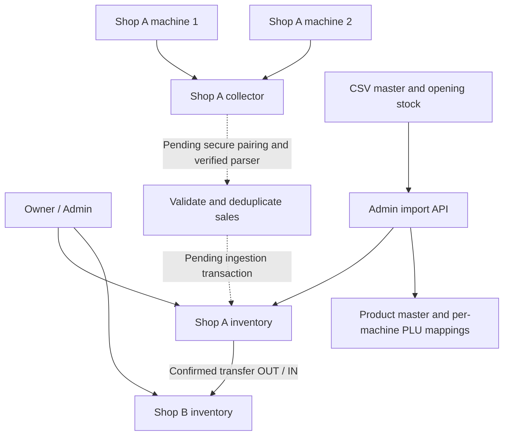

# Shop, machine and master upload integration

## Business rules

The single Admin is the owner across all shops. Shop users can access only their assigned shops. The database already enforces one Admin profile. Machine registration and master uploads are Admin-only.

Each shop has one inventory location and any number of registered machines. Machines do not own separate stock. For example, if opening stock is 20 kg and two machines sell 2 kg and 3 kg, the intended remaining stock is 15 kg, not two separate balances. Only validated, deduplicated sales may create stock movements.

Stock transfers use the existing Admin-confirmed transfer endpoint. A transfer creates equal OUT and IN movements in one transaction and checks source availability. Low stock does not automatically create a transfer. Alert thresholds and suggested replenishment are still pending.



## Machine identity and registration

Use three distinct concepts:

| Value | Purpose | Example |
| --- | --- | --- |
| Application device UUID | Permanent database identity | Returned by registration |
| Physical asset label | Unique label affixed to the actual scale | SHOP01-SCALE01 |
| LAN IP and port | Connection address on the collector | 192.168.1.50:4001 |

The current schema calls the asset label `hardwareIdentifier`. This is owner-entered inventory identification, not an automatically verified manufacturer serial number. The registration API normalizes it to uppercase and enforces uniqueness. An IP address is rejected as an asset label. A confirmed manufacturer serial can be recorded separately in a future extension; the reviewed Dahua evidence has not established a reliable serial-query command.

Register each physical scale once, affix its label, then retain its UUID in the collector configuration. Replacing a scale means creating a new registration, not reusing its old record sequence. Do not recreate a device when its IP changes. Moving a scale between shops needs an audited reassignment workflow that preserves historical ownership; no move endpoint is provided yet.

Registration is not authentication or pairing. Before live ingestion, issue a revocable collector credential bound server-side to its allowed device UUIDs. Never accept an arbitrary client-provided shop ID as the sale destination. Resolve it from the authorized registered device. Do not use a UUID or asset label as a password.

The collector must reach the machine on the local network. Ethernet and Wi-Fi can coexist if routing permits it. Mobile phones only need access to the API and do not need the scale's Wi-Fi. Do not expose TCP port 4001 to the public internet.

## Implemented API endpoints

All routes below are under `/api/v1`. Send `Authorization: Bearer <Supabase access token>`. The owner must also have an active Admin application profile.

| Method | Route | Purpose |
| --- | --- | --- |
| POST | `/machines` | Register a scale to an active shop |
| GET | `/machines?shopId=<uuid>` | List that shop's machines, with shop authorization |
| POST | `/master-imports/preview` | Parse and preview CSV format, without database writes |
| POST | `/master-imports` | Commit products, PLU mappings and locked opening stock atomically |
| POST | `/machine-plu-mappings` | Add mappings to an existing machine without opening-stock changes |

Registration and commit require `Idempotency-Key`. Retry the same request using the same key. Changing its contents requires a new key. Duplicate asset labels or an existing shop/date opening baseline still cause a conflict even with a new key.

Registration JSON:

```json
{
  "shopId": "<existing-shop-uuid>",
  "name": "Counter 1",
  "machineType": "DAHUA_TM_A",
  "hardwareIdentifier": "SHOP01-SCALE01"
}
```

`machineType` accepts `DAHUA_TM_A` or `LONGFLY`. This is registration metadata, not proof of supported transaction retrieval. Response includes the device `id`, `locationId` and `connectionStatus: NOT_PAIRED`.

## CSV import contract

Use this exact header order. CSV supports UTF-8 BOM, CRLF, quoted commas and escaped quotes. There is a limit of 500 product rows and 250,000 characters.

```csv
product_code,name,plu,initial_price_per_kg,opening_kg,recovery_percent
TOMATO,Tomato,0001,35.50,20.000,40
APPLE,Apple,0002,150.00,12.500,50
```

- Product codes are stable uppercase codes, independent of machine PLUs.
- PLUs are digit strings. Preserve leading zeros when editing in Excel. Hardware-specific widths and leading-zero equivalence still require protocol validation.
- Prices are rupees per kg, with up to two decimals. Quantities are kg, with up to three decimals. Conversion uses exact integers, not floating-point arithmetic.
- Recovery percent ranges from 0 to 100, with up to two decimals.
- Each product and PLU may occur only once per file.
- Select 1 to 50 registered machines belonging to the same shop. The file's PLUs are assigned to every selected machine. Opening stock is inserted once, regardless of machine count.
- All selected machines must use this PLU layout. Import rejects an existing PLU mapped to a different product. It never silently reassigns a historical mapping.
- New products receive the initial price. Existing product prices are ignored by this import and are never overwritten. Existing name and recovery percent must match the master. Use the separate product-price endpoint for price changes.
- Opening stock is a complete daily physical baseline for the shop, not an incremental delivery. An existing submission is locked and cannot be overwritten by this API. Use purchase or transfer workflows for later arrivals.
- The preview validates format only. Commit checks current database conflicts and rolls back every write on failure.
- This API does not send any PLU or price commands to physical scales. `hardwareUpdated` is always false.

Request body for both preview and commit:

```json
{
  "shopId": "<shop-uuid>",
  "businessDate": "2026-10-18",
  "deviceIds": ["<machine-1-uuid>", "<machine-2-uuid>"],
  "csv": "product_code,name,plu,initial_price_per_kg,opening_kg,recovery_percent\nTOMATO,Tomato,0001,35.50,20.000,40"
}
```

PowerShell example after registering the machines:

```powershell
$api = 'http://localhost:3000/api/v1'
$headers = @{ Authorization = "Bearer $env:INVENTORY_ACCESS_TOKEN" }
$body = @{
  shopId = '<shop-uuid>'
  businessDate = '2026-10-18'
  deviceIds = @('<machine-1-uuid>', '<machine-2-uuid>')
  csv = Get-Content -LiteralPath 'D:\imports\master.csv' -Raw -Encoding utf8
} | ConvertTo-Json -Depth 5
Invoke-RestMethod -Method Post -Uri "$api/master-imports/preview" -Headers $headers -ContentType 'application/json; charset=utf-8' -Body ([Text.Encoding]::UTF8.GetBytes($body))
# Review the preview before committing. Retain this key for retries.
$headers['Idempotency-Key'] = [guid]::NewGuid().ToString()
Invoke-RestMethod -Method Post -Uri "$api/master-imports" -Headers $headers -ContentType 'application/json; charset=utf-8' -Body ([Text.Encoding]::UTF8.GetBytes($body))
```

The existing schema supports these additions; no new migration was needed. Existing migrations still need to be applied to staging.

## Remaining before live operation

Standalone mapping request: `{ "deviceId": "<uuid>", "mappings": [{ "pluCode": "0001", "productId": "<uuid>" }] }`. It requires owner authorization and an Idempotency-Key, supports up to 500 unique PLUs, and rejects conflicting historical mappings. It never programs physical hardware.

1. Provision staging PostgreSQL/Supabase and test rollback, simultaneous imports, retries, PLU conflicts and cross-shop access against the real database.
2. Staging-test live mobile CSV-content preview/confirmation, registration and machine lists. Add native CSV file selection; pasted contents are currently supported. Other demo screens remain separate.
3. Implement secure collector pairing, credential revocation, connection configuration and heartbeat status. Registration does not establish a network connection.
4. Capture and validate actual Dahua receipts against raw records, including units, totals, PLUs, receipt grouping and record resets. Longfly transaction support must be established independently.
5. Implement the ingestion transaction: persist raw event, validate mapping, resolve registered shop, create sale/items and inventory movements atomically. Quarantine unknown PLUs and ambiguous records without deducting stock.
6. Deduplicate by device UUID plus verified record epoch and sequence. Two machines may both emit sequence 1. A sequence alone is not globally unique. Detect reset/rollover before advancing the epoch; do not guess.
7. Standalone audited PLU mapping is implemented for newly added machines. Add acknowledged hardware price synchronization and an audited historical remapping policy. Do not repeat opening stock to provision a new machine.
8. Add low-stock thresholds/alerts and owner-approved replenishment suggestions. Existing transfers remain explicit confirmed operations.

Automatic machine-driven stock deductions are not yet enabled. This boundary protects inventory from unverified parsing and duplicate receipts.
